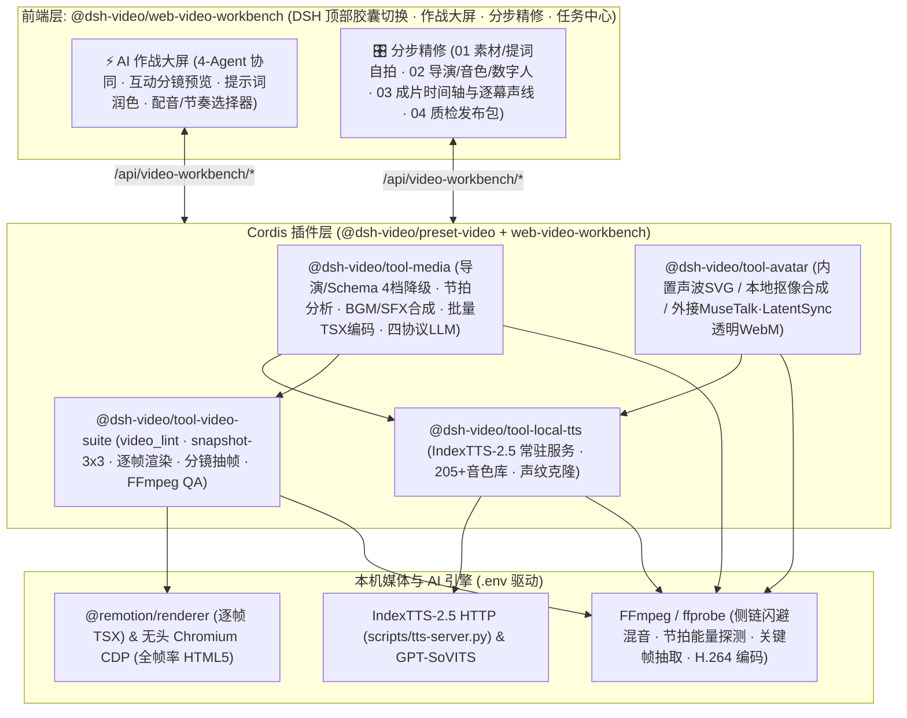

# 🎬 DSH Video Workbench (`dsh-video-workbench`)

> **面向 DeepSeek Harness (DSH) 的双引擎（Remotion 4.x TSX & HyperFrames HTML5/Canvas）多智能体 AI 视频全链路工作台插件套件**  
> **Dual-Engine (Remotion & HTML5) Multi-Agent AI Video Studio for DeepSeek Harness — Import Assets, AI Script & Prompt Polish, BGM Beat-Sync, IndexTTS-2.5 Voice & Clone, Custom TSX Coding & Full-FPS MP4**

[](./LICENSE)
[](#)
[](#)
[](#)

---

## 📖 目录 / Table of Contents
- [一、核心特性 (Features)](#-一核心特性-features)
- [二、系统架构图 (Architecture)](#-二系统架构图-architecture)
- [三、工作台使用指南（AI 作战大屏 + 分步精修）](#-三工作台使用指南ai-作战大屏--分步精修)
- [四、Windows 11 安装与挂载 DeepSeek Harness (Quick Start)](#-四windows-11-安装与挂载-deepseek-harness-quick-start)
- [五、本地 IndexTTS-2.5 与声音克隆指南](#-五本地-indextts-25-与声音克隆指南)
- [六、数字人叠加引擎说明 (`@dsh-video/tool-avatar`)](#-六数字人叠加引擎说明-dsh-videotool-avatar)
- [七、常见问题排查 (Troubleshooting)](#-七常见问题排查-troubleshooting)
- [八、English Documentation](#-八english-documentation)

---

## ✨ 一、核心特性 (Features)

1. **⚡ 4-Agent AI 作战大屏 + 分步精修工作台 + 实时任务监控**：
   - **策划导演 Agent → 素材剪辑 Agent → 配音混音 Agent → 动效质检 & MP4 导出 Agent** 全程可视化接力运行，支持随时暂停、恢复、强停子进程与断点单步重试。
   - 接入 DeepSeek Harness 桌面端后，可通过左侧栏入口切换进入工作台，工作台左上角提供 **`← DeepSeek 对话 | 🎬 AI 视频工坊`** 胶囊随时一键返回对话，简洁不遮挡标题栏。
2. **🧠 通用四协议大模型接入 + ✨ AI 一键润色提示词**：
   - 支持 **跟随 DSH 客户端自动同步 (`follow-dsh`)** 或插件独立配置，原生兼容 **OpenAI `/v1/chat/completions`**、**Anthropic `/v1/messages`**、**OpenAI `/v1/responses`** 与 **Google Gemini `/v1beta/models`** 四种接口协议。
   - **第 2 步「✨ AI 一键润色提示词」**：只需写一句大白话需求，AI 会结合已上传的图片/视频/BGM 与笔记内容一键扩写成专业导演指令并覆盖替换，支持 **「↩ 恢复原句」**。
3. **🥁 音乐节拍踩点引擎 & 三种配音节奏模式 (`tts` / `tts-beat-sync` / `subtitle-mv`)**：
   - 上传个人 BGM 后自动调用 FFmpeg 波形能量包络探测 **真实 BPM、首拍相位与高潮突降点 (Drops)**。
   - 前端提供明确选择器自由切换：
     - `🗣️ AI 真人配音`：逐幕调用本地 `IndexTTS-2.5` 合成人声旁白 + AI 声学修音 + 自动闪避混音；
     - `⚡ AI 配音+踩拍切镜`：保留真人旁白并让分镜切入贴合音乐节拍；
     - `🔥 纯音乐卡点 (免 TTS)`：跳过语音合成，按 `0.5` / `1` / `2` / `4` 拍自动对准重拍与高潮切镜，输出高燃纯动画 MV 与卡点音效。
   - **依题材自适应节奏 (`auto` / `calm` / `balanced` / `dynamic`)**：不再一刀切套用历史片快闪节奏——品牌故事温情短片自动保持 `4~7s/镜` 从容留白，产品功能/教程保持 `3~5s/镜` 清晰解说，历史卡点 MV 才启用高速半拍闪烁切镜。
4. **🎬 Remotion 批量自定义 TSX 编码 + Step 3 成片原画同步精修**：
   - **Remotion 4.x 引擎** 由大模型分批次手写逐镜 TSX 矢量动画/排版组件（经静态安全沙箱 + `video_lint` + `tsc --noEmit` 最多 3 轮自动修复），无素材题材同样可生成高密度矢量舞台与视觉演出。
   - **Step 3 监看台与作战大屏互动分镜预览**：自动通过 FFmpeg 从 `final.mp4` 为全部分镜抽取实景关键帧缩略图 (`output/scene-thumbs/*.jpg`)，Remotion AI 成片直接支持 **「🎬 成片原画时间轴」** 点击分镜精准跳转，彻底避免 HTML5 骨架稿与 Remotion 实景成片画面不一致的错位感。
   - **AI 辅助创作角标 (`aiBadge`)**：支持自由开启/关闭及 **右上角（默认）/ 左上角 / 右下角 / 左下角** 四角自由切换，避免遮挡主体标题。
5. **🎙️ 多引擎灵活配音（`IndexTTS-2.5` / `IndexTTS-2` · `GPT-SoVITS` 低显存 · 自定义模型导入）(`@dsh-video/tool-local-tts`)**：
   - **不被单一模型绑定**：工作台内置 **「多引擎配音中心」**，可一键切换 **`IndexTTS-2.5`**（8GB+ 高保真情感克隆）、**`IndexTTS-2`**，或专为低显存电脑保留的 **`GPT-SoVITS`**（4GB+ 显存轻量快速，兼容 `api_v2.py` 与 `v1`）；
   - **支持自由添加/导入其他配音模型**：内置 OpenAI `/v1/audio/speech` 协议（Fish Speech、Kokoro 82M、OneAPI/SiliconFlow）、通用 HTTP JSON/GET（CosyVoice、ChatTTS、Sherpa-ONNX）以及 **零显卡纯 CPU 本地命令行**（如 `edge-tts`）模板，支持 JSON 导入导出分享与一键试听测试；
   - 内置 205+ 音色标签库、浏览器录音降噪克隆与 `ffprobe` 实测帧数精确回填。
6. **开源商用合规 & 零硬编码敏感路径**：
   - 内置商用免费开源 OFL 字体族（`Noto Sans SC`、`Source Han Serif SC Heavy`、`JetBrains Mono`），`video_lint` 自动拦截未授权商用系统字体。
   - 全部本机路径与接口密钥均由未追踪的 `.env` 驱动，仓库内零硬编码私人路径与密钥。

---

## 🏗️ 二、系统架构图 (Architecture)



---

## 🎯 三、工作台使用指南（AI 作战大屏 + 分步精修）

1. **创建或切换视频工程**：点击左上角工程下拉胶囊，新建空工程或切换现有工程；顶栏支持随时在 **`← DeepSeek 对话`** 与 **`🎬 AI 视频工坊`** 之间无损切换。
2. **Card 1 · 导入素材 / 极速备料**：拖拽图片、视频片段、背景音乐 (`BGM`)、文本笔记 (`txt`/`md`)，或点击「一键加载演示素材」/「打开提词器自拍」。
3. **Card 2 · 编写或 AI 润色指令 + 选定节奏与配音方式**：
   - 输入一句简单想法，点击右上角 **「✨ AI 一键润色提示词」** 自动生成专业导演指令（不满意可点 **「↩ 恢复原句」**）；
   - 按需选择 **画面比例**、**视觉基调风格**、**节奏适配方案 (`AI智能适配` / `舒缓` / `稳健` / `高燃`)**、**AI 辅助角标开关与四角位置**，以及 **配音与卡点节奏模式 (`AI真人配音` / `配音+踩拍` / `纯音乐卡点免TTS`)**。
4. **Card 3 · 发车检查并启动 4-Agent 全自动出片**：等待 4 张 Agent 卡片接力跑完，中心自动切出高清 MP4 播放器或跳转 **第 3 步「监看台与改片」** 逐幕精修文案、替换单幕配音音色或用自然语言让 AI 重写单幕特效。

---

## 🚀 四、Windows 11 安装与挂载 DeepSeek Harness (Quick Start)

### 前置依赖（按需准备）
- **必装**：
  - [Node.js](https://nodejs.org/) `>= 20.0.0`（推荐 Node 22 / 24）
  - `FFmpeg` 与 `ffprobe`（已加入系统 `PATH`，或稍后在 `.env` 中指定绝对路径）
  - Windows 系统已安装 **Microsoft Edge** 或 Chrome（用于 HTML5 无头 Chromium CDP 逐帧渲染）
- **可选（按需开启对应引擎）**：
  - **本地真人配音 / 克隆 (`IndexTTS-2.5` 推荐)**：本机准备 [IndexTTS-2.5](https://github.com/index-tts/index-tts) 仓库目录（包含 `indextts/infer_v2_5.py`、`checkpoints/config.yaml` 与模型权重），并拥有可运行其推理的 Python 环境（支持 GPU BF16 推理，亦兼容旧版 `IndexTTS-2` 与 `GPT-SoVITS`）。如暂未部署本地 TTS，仍可使用「纯音乐卡点 (免 TTS)」模式或配置外接语音/字幕工作流。
  - **Remotion 引擎**：本机准备一个包含 `@remotion/bundler`、`@remotion/renderer`、`remotion`、`react` 的模板工程目录（在 `.env` 填入 `REMOTION_TEMPLATE_ROOT`）；如暂不安装 Remotion，可直接使用开箱即用的 **HTML5 动效引擎**。

### 安装步骤

```powershell
# 1. 克隆仓库
git clone https://github.com/Merziller/dsh-video-workbench.git
cd dsh-video-workbench

# 2. 复制环境变量模板并填写你本机的真实路径
Copy-Item .env.example .env
```

编辑 `.env`（常用核心字段如下，具体见 [`.env.example`](./.env.example)）：

```env
# 必填/推荐：FFmpeg 与 ffprobe 可执行文件路径
FFMPEG_PATH=D:/your_tools/ffmpeg/ffmpeg.exe
FFPROBE_PATH=D:/your_tools/ffmpeg/ffprobe.exe

# 本地 IndexTTS-2.5（推荐）
DEFAULT_TTS_ENGINE=indextts25
INDEXTTS_ROOT=D:/your_path/index-tts
INDEXTTS_PYTHON=D:/your_path/index-tts/.venv/Scripts/python.exe
INDEXTTS_ENDPOINT=http://127.0.0.1:9880

# Remotion 引擎模板目录（若需使用 Remotion 4.x 渲染）
REMOTION_TEMPLATE_ROOT=D:/your_path/remotion-template
```

### 方式 A：一行命令 / DSH 插件市场一键静默安装（推荐，免配置 Remotion 与 FFmpeg）

本仓库根目录已构建为标准单包 DSH Bundle（零 `workspace:*` 依赖、零 `postinstall` 构建脚本），声明并随包自动安装 **`remotion`、`@remotion/bundler`、`@remotion/renderer`、`react`、`typescript`、`@ffmpeg-installer/ffmpeg`、`@ffprobe-installer/ffprobe`**，且在 Windows 下可自动复用系统自带 Microsoft Edge 完成 Remotion 与 HTML5 出片，无需用户再手动下载安装 Remotion 工程或配置 `FFMPEG_PATH`。

```powershell
# 直接从 GitHub 安装到 DSH 桌面端或 web profile（自动静默拉齐 Remotion + FFmpeg 依赖）
dsh plugin --profile desktop add github:Merziller/dsh-video-workbench
```

> 若通过 **dshmarket / DSH「发现」插件市场** 搜到 `dsh-video-workbench`，点击卡片「**安装**」即可静默完成，完全无需命令行与手动配依赖；若本机另有本地 `IndexTTS-2.5` / `GPT-SoVITS` 配音模型，才需在界面弹窗里填写服务地址或可选目录。

### 方式 B：克隆源码开发挂载（同步工作区软链到本机 DSH 桌面端）

```powershell
# 拉取源码后先安装运行依赖，再一键软链到 ~/.dsh/profiles/desktop
pnpm install
node scripts/install-profile.mjs
```

执行成功后：**完全退出并重新启动 DeepSeek Harness 客户端**，在左侧边栏即可切换进入 **`🎬 AI 视频工坊`**（工作台左上角提供 **`← DeepSeek 对话`** 胶囊随时切回主对话），大模型预设会自动挂载 **`视频制作模式 (video-maker)`**（会自动同步读取你在 DSH 客户端中配置好的模型与 API Key）。

### 方式 C：独立浏览器运行（支持系统浏览器直接开启摄像头自拍）

```powershell
# 启动独立 Web 控制台（默认监听 http://127.0.0.1:4399，可用 DSH_VIDEO_PORT 改端口）
node scripts/dsh-runner.mjs video --keep-alive

# 或者使用快捷脚本（Windows 下若 4399 已被旧进程占用请先关闭旧窗口或改 DSH_VIDEO_PORT）
.\pnpm.cmd dsh video --keep-alive
```

### 验证安装与发布自检（全链条 16 关自测 + 单包打包验证）

```powershell
# 运行全链路 16 关端到端自动化验证
node scripts/self-test.mjs

# 检验 DSH 市场分发 .tgz 安装包是否自包含且无敏感文件泄露
node scripts/pack-bundle.mjs
```

> 说明：`self-test.mjs` 会完整测试 FFmpeg/FFprobe 解析（含内置 zero-script 二进制与系统二进制）、24 个 Cordis 工具注册、`IndexTTS-2.5` 常驻健康检查与真人配音（需已配置 `INDEXTTS_ROOT` / 可访问服务端）、HTML5 & Remotion 双引擎渲染、四协议 LLM 模拟自愈、BGM 节拍解析、DSH 同步槽位加载、无 `workspace:*` 依赖清单检查，以及开源合规与脱敏路径扫描。

> 📦 **上架 DSH 插件市场（awesome-dsh-plugin）**：仓库已预置 [`.github/workflows/release.yml`](./.github/workflows/release.yml)（打 `v*` Tag 自动构建 Release `.tgz` 预构建包）与 [`docs/awesome-dsh-plugin-entry.yml`](./docs/awesome-dsh-plugin-entry.yml)（标准目录条目模板）；推送仓库并给 GitHub 仓库添加 **`dsh-plugin`** Topic 标签后，即可向 `awesome-dsh-plugin/awesome-dsh-plugin` 提交 PR 收录。

---

## 🎙️ 五、多引擎配音（IndexTTS-2.5 / GPT-SoVITS / 自定义模型）与声音克隆指南

- **IndexTTS-2.5 常驻服务自动拉起**：选中 `IndexTTS-2.5` 并调用 `generate_speech` / 一键出片时，插件会自动探测 `INDEXTTS_ENDPOINT`（默认 `http://127.0.0.1:9880`），若尚未启动则会使用 `INDEXTTS_PYTHON` 自动拉起 [`scripts/tts-server.py`](./scripts/tts-server.py) 常驻内存（支持 `.env` 的 `INDEXTTS_QWEN_EMO=1` 启用 Qwen 情绪控制）。
- **GPT-SoVITS（低显存电脑首选）**：在工作台顶栏点击 **「配音: ...」** 或进入第 2 步点击 **「GPT-SoVITS (低显存)」** 即可直接切换；支持连接你本机已启动的 `api_v2.py` / `api.py`（默认 `http://127.0.0.1:9881`，可在面板中自由修改端口或填根目录自动拉起）。
- **自定义 / 导入其他配音模型（含纯 CPU 免显卡方案）**：在「多引擎配音中心 → ➕ 添加自定义配音模型」中，可一键载入 **`Edge-TTS (0GB 纯 CPU)`**、**`Fish Speech / OpenAI /v1/audio/speech`**、**`Kokoro 82M (超轻量)`**、**`CosyVoice / ChatTTS HTTP`** 等模板，或自定义 JSON 导入与一键测试试听。
- **205+ 音色库 & 一键声纹克隆**：打开 **「选音色 / 克隆我的声音」** 弹窗，支持试听预置/本地扫描音色，也支持上传任意清晰干声 `.wav` / `.mp3` 或麦克风录音一键降噪标准化入库与试听。

---

## 🤖 六、数字人叠加引擎说明 (`@dsh-video/tool-avatar`)

插件本着工程诚实原则，在工作台与后端均清楚区分了两种模式（均为带透明 Alpha 通道 `yuva420p` `.webm` 输出）：
1. **免外部 GPU 算力的内置模式（开箱即用）**：
   - **纯 AI 主播形象 (`ai-human`)**：读取逐句合成的语音 WAV 振幅包络（RMS），驱动内置赛博/温暖/极客矢量人物进行实时口型张合与眨眼动画，经无头 Chromium 录制成透明 `.webm` 叠加到画面角落或全屏。
   - **克隆真人底板 (`cloned-human`)**：用 `IndexTTS-2.5` 克隆本人声音，并用 FFmpeg 对上传的本人写真图/出镜视频做圆角画中画或绿幕色键 (`chromakey`) 抠像叠加（**此默认本地模式不做静态照神经网络唇形改写**）。
2. **外接真实神经网络对口型服务（可选扩展）**：
   - 在 Step 2 数字人卡片右上角点 **「⚙ 引擎配置」**（或编辑 `.env` 中的 `AVATAR_PROVIDER` / `AVATAR_ENDPOINT` / `AVATAR_API_KEY`），填入你部署的 **MuseTalk** 或 **LatentSync** 推理接口，插件即可把真人头像+配音提交到远程生成真实唇形驱动的透明 `.webm`。

---

## 🔧 七、常见问题排查 (Troubleshooting)

1. **在 DSH Desktop 客户端里点击「开启摄像头与麦克风」提示 `Permission denied` 怎么办？**
   - 原因通常为 Electron 桌面客户端内置 Webview 默认未放行相机权限，或 Windows「设置 → 隐私和安全性 → 相机/麦克风 → 允许桌面应用访问」被关闭。
   - 解决：工作台提词自拍弹窗已内置零阻塞退路——会先尝试单独降级为仅麦克风录音；若均被拦截，可直接点弹窗内的 **「🌐 在系统浏览器中打开自拍」**（用 Chrome/Edge 打开独立网页端口 `4399` 正常授权录制），或点 **「📁 直接上传本机已录视频/音频入库」** 把手机/系统相机录好的文件一键导入为出镜底板并提取克隆声纹。
2. **如果单独打开 `http://127.0.0.1:4399` 遇到黑屏或端口被占用怎么办？**
   - 原因通常为本机后台残留了旧版本 `dsh-runner.mjs` 监听在 `4399`，导致浏览器拉到新旧不匹配脚本，或外部 CDN 访问过慢。
   - 解决：最新版 [`scripts/dsh-runner.mjs`](./scripts/dsh-runner.mjs) 与 [`start-workbench.cmd`](./start-workbench.cmd) 已内置多 CDN 容错与清晰启动诊断卡（不再黑屏），并支持检测到 `4399` 被占用时自动顺延空闲端口（`4400+`）再自动打开对应 URL；在 DeepSeek Harness 客户端内点击「AI 视频工坊」则直接走内置本地宿主通道，完全无需外网 CDN。
3. **如何制作“纯音乐卡点动画（完全跳过 AI 配音）”？**
   - 在 AI 作战大屏 **第 2 张卡片最下方「🥁 配音与卡点节奏模式」**（或分步创作台第 2 步右侧）直接切换为 **「🔥 纯音乐卡点 (免 TTS)」** 即可；上传个人 BGM 后会自动对齐重拍与高潮段落。

---

## 🌐 八、English Documentation

### Overview
**DSH Video Workbench (`dsh-video-workbench`)** is an open-source multi-agent Cordis plugin suite for **DeepSeek Harness (DSH)** on Windows 11. It orchestrates a 4-Agent pipeline (`Director → Asset Editor → TTS/SFX/BGM Mixer → Motion Coder & QA Renderer`) supporting **Remotion 4.x TSX** and **HyperFrames HTML5/Canvas** engines, adaptive genre pacing, FFT/RMS BGM beat-sync (`tts`, `tts-beat-sync`, `subtitle-mv`), multi-engine TTS (`IndexTTS-2.5`, `IndexTTS-2`, low-VRAM `GPT-SoVITS`, plus extensible OpenAI/HTTP/CPU-CLI model import) with voice cloning, commercial-safe OFL typography (`Noto Sans SC`, `Source Han Serif SC Heavy`, `JetBrains Mono`), and model-agnostic 4-protocol LLM authoring (`OpenAI Chat`, `Anthropic Messages`, `OpenAI Responses`, `Gemini Native`).

### Package Structure
- `packages/shared`: Zero-hardcode `.env` loader, Windows sandbox-safe `ffmpeg`/`ffprobe` runner, OFL font sync, and safe-zone compliance calculator.
- `packages/dsh-tool-media`: Multimodal director & 4-tier schema degradation planner (`plan-schema.js`), FFT/energy BGM beat analyzer (`beat-analyzer.js`), DSP 48kHz WAV synthesizer & ducked mixer, adaptive genre pacing, and batched Remotion TSX / HTML5 coder (`ai-coder.js`).
- `packages/dsh-tool-local-tts`: Multi-engine TTS adapter (`IndexTTS-2.5` persistent server, `IndexTTS-2`, low-VRAM `GPT-SoVITS` `api_v2.py`/v1, plus importable OpenAI `/v1/audio/speech`, custom HTTP JSON, and CPU CLI models like `edge-tts`), 205+ voice catalog, voice cloning, and `ffprobe` duration alignment.
- `packages/dsh-tool-avatar`: Transparent `yuva420p` WebM digital human compositor (RMS-driven SVG anchor, FFmpeg squircle/chromakey overlay, and pluggable external MuseTalk / LatentSync REST adapter).
- `packages/dsh-tool-video-suite`: Static sandbox linter, 3×3 contact sheet snapshots, keyframe thumbnail extractor (`output/scene-thumbs/*.jpg`), full-FPS CDP / `@remotion/renderer` exporter, and FFmpeg loudness/black-frame QA.
- `packages/dsh-preset-video`: Registers the `视频制作模式` (`video-maker`) DSH Agent Preset and project scaffolder.
- `packages/dsh-web-video-workbench`: Registers `/api/video-workbench/*` endpoints and the DSH Desktop `main` (with top-left `← DeepSeek 对话` layout switcher), `sidebar.panellist`, and `tool.call.toolview` UI slots.

### License
Released under the [MIT License](./LICENSE).
