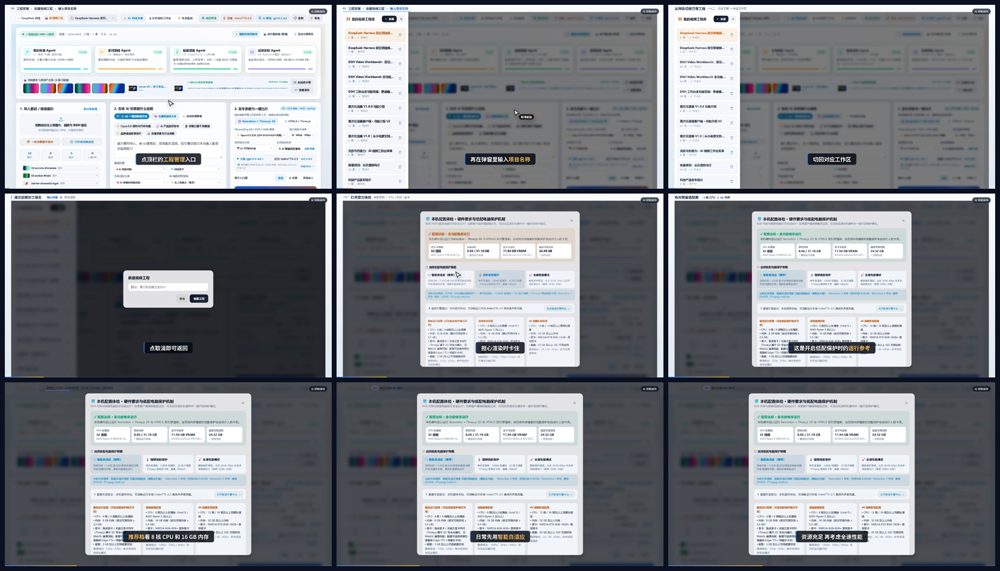
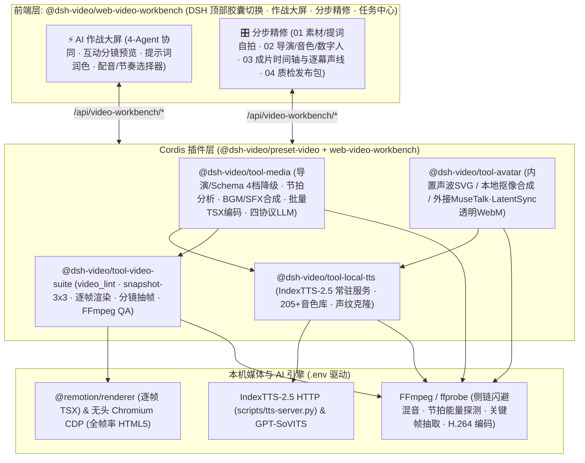

# 🎬 DSH Video Workbench (`dsh-video-workbench` · v0.4.0)

> **全智能体通用双引擎 AI 视频全链路工作台（不再局限于 DSH！原生支持 DeepSeek Harness · Claude Code · OpenAI Codex CLI · WorkBuddy · Cursor · Windsurf · Cline · Antigravity · 独立网页）**  
> **Universal Multi-Agent Dual-Engine AI Video Studio (Remotion 4.x + Three.js 3D & HyperFrames HTML5) — Reference Video Reverse-Engineering & Same-Style Remake (`MOTION.md` + Brand Kit), Beat-Synced Historical/MV Silhouette & Combat VFX, Optional One-Click Local TTS Installer (`Edge-TTS` / `IndexTTS-2.5` / `GPT-SoVITS` / `Windows Native`), & Low-Spec Protection**

[](./LICENSE)
[](#-四全智能体安装与接入指南不限-dsh-universal-multi-agent-setup)
[](#)
[](#-联系作者与原创版权声明-author--copyright)
[](#-联系作者与原创版权声明-author--copyright)
[](#-联系作者与原创版权声明-author--copyright)
[](#-联系作者与原创版权声明-author--copyright)

> 🛡️ **原创开源署名声明**：本项目由 **Merziller** 原创开源并依据 [MIT 协议](./LICENSE) 免费提供使用。任何二次分发、修改、打包、转载或商业/演示使用，**必须完整保留原作者署名与联系方式（作者：`Merziller` ｜ QQ：`1411574209` ｜ 微信：`Merziller` ｜ Gmail：`k26789228@gmail.com` ｜ 官方仓库：`https://github.com/Merziller/dsh-video-workbench`）**，严禁抹除作者信息冒充原创。详见 [`NOTICE`](./NOTICE)。

---

## 🎥 官方完整实操教程视频 & 可选本地配音安装器

> - **仓库内教程视频**：[`docs/tutorial/dsh-video-workbench-tutorial.mp4`](./docs/tutorial/dsh-video-workbench-tutorial.mp4)（1080P · 3 分 17 秒 · 由本插件全链路自动生成）
> - **GitHub Release 高速直链下载**：
>   - 插件全能单包：[`dsh-video-workbench-0.4.0.tgz`](https://github.com/Merziller/dsh-video-workbench/releases/download/v0.4.0/dsh-video-workbench-0.4.0.tgz)
>   - 可选本地配音一键安装包（`Edge-TTS` / `IndexTTS-2.5` / `GPT-SoVITS`）：[`dsh-tts-installer-pack-0.4.0.zip`](https://github.com/Merziller/dsh-video-workbench/releases/download/v0.4.0/dsh-tts-installer-pack-0.4.0.zip)
>   - 1080P 教程成片：[`dsh-video-workbench-tutorial.mp4`](https://github.com/Merziller/dsh-video-workbench/releases/download/v0.4.0/dsh-video-workbench-tutorial.mp4)
> - **作者联系（Bug 反馈 / 交流 / 建议）**：**QQ `1411574209`** ｜ **微信 `Merziller`** ｜ **Gmail `k26789228@gmail.com`**



---

## 📖 目录 / Table of Contents
- [🎥 官方完整实操教程视频](#-官方完整实操教程视频由本插件全流程自动生成)
- [一、核心特性 (Features)](#-一核心特性-features)
- [💻 电脑配置要求与低配电脑保护机制 (Hardware & Low-Spec Guard)](#-电脑配置要求与低配电脑保护机制-hardware--low-spec-guard)
- [二、系统架构图 (Architecture)](#-二系统架构图-architecture)
- [三、工作台使用指南（AI 作战大屏 + 分步精修）](#-三工作台使用指南ai-作战大屏--分步精修)
- [四、Windows 11 安装与挂载 DeepSeek Harness (Quick Start)](#-四windows-11-安装与挂载-deepseek-harness-quick-start)
- [五、本地 IndexTTS-2.5 与声音克隆指南](#-五本地-indextts-25-与声音克隆指南)
- [六、数字人叠加引擎说明 (`@dsh-video/tool-avatar`)](#-六数字人叠加引擎说明-dsh-videotool-avatar)
- [七、常见问题排查 (Troubleshooting)](#-七常见问题排查-troubleshooting)
- [📬 联系作者与交流反馈 (Contact)](#-联系作者与交流反馈-contact)
- [八、English Documentation](#-八english-documentation)

---

## ✨ 一、核心特性 (Features)

1. **⚡ 4-Agent AI 作战大屏 + 分步精修工作台 + 实时任务监控**：
   - **策划导演 Agent → 素材剪辑 Agent → 配音混音 Agent → 动效质检 & MP4 导出 Agent** 全程可视化接力运行，支持随时暂停、恢复、强停子进程与断点单步重试。
   - 接入 DeepSeek Harness 桌面端后，可通过左侧栏入口切换进入工作台，工作台左上角提供 **`← DeepSeek 对话 | 🎬 AI 视频工坊`** 胶囊随时一键返回对话，简洁不遮挡标题栏。
2. **🧠 通用四协议大模型接入 + ✨ AI 一键润色提示词**：
   - 支持 **跟随 DSH 客户端自动同步 (`follow-dsh`)** 或插件独立配置，原生兼容 **OpenAI `/v1/chat/completions`**、**Anthropic `/v1/messages`**、**OpenAI `/v1/responses`** 与 **Google Gemini `/v1beta/models`** 四种接口协议。
   - **第 2 步「✨ AI 一键润色提示词」**：只需写一句大白话需求，AI 会结合已上传的图片/视频/BGM 与笔记内容输出结构化方案（自动隔离 **观众可见标题/内容要点 (`displayTitle`/`contentOutline`)** 与 **AI 专用导演备注 (`directorNotes`)**），杜绝制作指令泄露到视频台词或屏幕画面；同时支持**全品类无限自由体裁路由**（内置 11 种常见题材参考起点 + 任意自创 `genreLabel` 全链路透传 + `freeform-stage` 零固定版式限制，涵盖代码动画、亮色高倍率软件教程、历史水墨剧场、火柴人角色动画、真人口播、数字人、科普图解、数据故事、产品宣发乃至任意冷门/自创新体裁）与 **「↩ 恢复原句」**。
   - **纯正中文字幕与发音引擎 (`subtitle-engine`)**：严格分离后台语音朗读文本 (`ttsText`) 与屏幕显示字幕 (`subtitleText`)，画面字幕自动保留自然阿拉伯数字（如 `206年`、`3000人`、`8 GB`）并剥离孤立引号，结合语义断句避免拆散词组或标点落单。
3. **🥁 音乐节拍踩点引擎 & 三种配音节奏模式 (`tts` / `tts-beat-sync` / `subtitle-mv`)**：
   - 上传个人 BGM 后自动调用 FFmpeg 波形能量包络探测 **真实 BPM、首拍相位与高潮突降点 (Drops)**。
   - 前端提供明确选择器自由切换：
     - `🗣️ AI 真人配音`：逐幕调用本地 `IndexTTS-2.5` 合成人声旁白 + AI 声学修音 + 自动闪避混音；
     - `⚡ AI 配音+踩拍切镜`：保留真人旁白并让分镜切入贴合音乐节拍；
     - `🔥 纯音乐卡点 (免 TTS)`：跳过语音合成，按 `0.5` / `1` / `2` / `4` 拍自动对准重拍与高潮切镜，输出高燃纯动画 MV 与卡点音效。
   - **依题材自适应节奏 (`auto` / `calm` / `balanced` / `dynamic`)**：不再一刀切套用历史片快闪节奏——品牌故事温情短片自动保持 `4~7s/镜` 从容留白，产品功能/教程保持 `3~5s/镜` 清晰解说，历史卡点 MV 才启用高速半拍闪烁切镜。
4. **🪐 Opus 5.5 级全开放自由编码 (`Freeform Three.js 3D` + 动态 `SVG` + `HUD` 遥测 + 节拍弹簧物理) + 内置保底预设**：
   - **真实交互式教程镜头、像素级坐标锚点与全链路无限制开放体裁 (`v0.3.4` ~ `v0.3.8`)**：支持高清晰亮色 UI 教程拍摄模式（`windowTheme: "light"`、`1.8x~2.4x` 局部特写推镜 `<FocusShot>`、`(0,0)` 尖端对齐光标与点击涟漪 `<InteractiveCursor>`、`clipPath` 平滑抽屉展开 `<UiDrawerSlide>` 及逐字打字 `<UiTypingOverlay>`，并自动挂载对齐 `click` / `whoosh` / `typing` 音效）；新增 **AI 大模型语义选音 (`castVoicesWithLlm`)**，自动索引本地高表现力精品音色并动态驱动 8 维情绪向量与语速曲线；**`v0.3.5`** 打通自创体裁标签 **`genreLabel` 全链路透传** 与 **`freeform-stage` 零固定版式策划**；**`v0.3.6`** 升级全四协议多模态视觉接口与像素级等比容器查询坐标系；**`v0.3.7`** 修复点击一键出片或切换工程后 AI 润色完整指令被清空/回显空白问题并新增母带 EBU R128 真峰值限幅；**`v0.3.8` ~ `v0.3.9`** 新增 **「⏱ 目标视频时长：AI 自由匹配 / 自定义时长（15~600 秒）」**（与 AI 一键润色、自然语言时长解析及防缩水自动补镜强联动），并将 **AI 润色超时上限升级至 10 分钟（`600s` + 异步后台任务轮询 + Node 原生 HTTP 长连接防 5 分钟 `headersTimeout` 断连）**；同时彻底打通 **上传 BGM 自动切换挂载、清晰踩拍混音（解决上传 BGM 无声/被压死）、自定义音效/文本笔记/声纹克隆/数字人底板全类型上传零遗漏采用**。
   - **真正无预设束缚的 AI 自由造景 (`<FreeformThreeStage />` + 动态 `<svg>`)**：在大模型编码模式下，AI 不再被固定模板或预设数量捆死！插件直接把原生 **`THREE.*`** 几何与相机接口（`FreeformThreeApi`：`addMesh` / `addLine3D` / `addParticle3D` / `addLabel3D` / `orbitPoint` / `arc3D`）、动态 **`<svg>`** 曲线工具（`buildSmoothSvgPath` / `describeSvgArc`）与 **HTML5 3D 透视投影** 开放给大模型主程，AI 可针对任意题材从零自由编写专属 3D 旋转地球、3D 芯片爆炸拆解、K线雷达图、思维导图或公式推演；内置 6 大 3D 舞台、5 种动态 SVG 拓扑 (`<SvgArchitectureDiagram />`) 与全息 HUD 代码面板 (`<HudDataDashboard />` + `<HudTelemetryOverlay />`) 既可作原子积木混搭，也作离线/容错保底。
   - **支柱 ① · 原生 `three` + `@remotion/three` (`<ThreeCyberStage />` / `ThreeCanvas`)**：内置 6 大帧级确定性 Three.js 3D 空间舞台预设（`orbital-core` 3D 量子二十面体与三轴陀螺仪星环、`cyber-terrain` 3D 赛博山谷网格与日冕门户、`particle-vortex` 3D 星云漩涡与神经网络突触、`floating-monoliths` 3D 空间悬浮晶碑矩阵、`chrono-helix` 3D 时空双螺旋隧道、`matrix-cubes` 3D 算力矩阵波浪），逐帧随音乐重拍脉冲与相机推拉同步响应。
   - **支柱 ② · 动态 SVG 系统架构拓扑图 (`<SvgArchitectureDiagram />` / `svg-architecture-flow`)**：内置 5 种可编程架构拓扑（`neural-pipeline`、`microservice-mesh`、`layered-stack`、`radial-hub`、`ast-tree`），包含弹簧逐级弹出的架构节点卡、三次贝塞尔发光电路总线与沿路径高速穿梭的数据包光子脉冲 (`<circle>`)。
   - **支柱 ③ · 全息 HUD 遥测数据与实时代码流面板 (`<HudDataDashboard />` + `<HudTelemetryOverlay />` / `hud-telemetry-dashboard`)**：左侧实时滚动语法高亮的 TSX / Agent 执行代码流，右侧配备 3 组 SVG 环形进度仪表盘 + `DigitRoll` 数字滚轮与实时跟踪游标的 SVG 样条遥测波形图，四周叠加广播级 `TC MM:SS:FF` 时间码、旋转陀螺准星与 18 段重拍频谱仪。
   - **支柱 ④ · 节拍同步弹簧物理引擎 (`computeBeatSpring` + `<BeatSpringPhysicsRig />` / `vibecoding-spring-stage`)**：将 Remotion `spring()` 阻尼刚度物理模型 (`damping: 13.5, stiffness: 175`)、`interpolate()` 确定性插值与音乐 `beats[]` 重拍冲击波深度耦合，赋予每个镜头与组件真实的欠阻尼回弹、三维透视倾角 (`rotateX/Y`) 与高速运动色散。
   - **AI 作战大屏一站式发车控制台**：无需跳转进入分步精修第 2 步，直接在作战大屏第 3 卡片即可自由切换 **`⚛️ Remotion + Three.js 3D`** 与 **`🌐 HTML5 + Three.js`** 渲染引擎、**`🪐 Vibecoding 3D / SVG / HUD 视效模式`**、**`📺 画质与帧率`**（`1080p`/`2K`/`4K` · `30fps`/`60fps`）、**`🎹 背景配乐方案`**、**`🎙 主讲音色/克隆`** 与 **`数字人口播`**，所有参数实时同步落盘。
   - **Step 3 监看台与作战大屏互动分镜预览 + 预设版式直切**：自动通过 FFmpeg 从 `final.mp4` 为全部分镜抽取实景关键帧缩略图 (`output/scene-thumbs/*.jpg`)，Remotion AI 成片直接支持 **「🎬 成片原画时间轴」** 点击分镜精准跳转；在 AI 自由编码模式下，若某幕想快速切回内置版式（如 `split-stage`、`hud-telemetry-dashboard` 等），在监看台第 3 步下拉选择对应版式（自动标记 `useBuiltinLayout`）即可实时覆盖生效。
   - **AI 辅助创作角标 (`aiBadge`)**：支持自由开启/关闭及 **右上角（默认）/ 左上角 / 右下角 / 左下角** 四角自由切换，避免遮挡主体标题。
5. **🎙️ 多引擎灵活配音（`IndexTTS-2.5` / `IndexTTS-2` · `GPT-SoVITS` 低显存 · `Windows 系统原生纯CPU` · 自定义模型）(`@dsh-video/tool-local-tts`)**：
   - **不被单一模型绑定**：工作台内置 **「多引擎配音中心」**，可一键切换 **`IndexTTS-2.5`**（8GB+ 高保真情感克隆）、**`IndexTTS-2`**、**`GPT-SoVITS`**（4GB+ 显存轻量快速，兼容 `api_v2.py` 与 `v1`），以及面向**零独显低配电脑**的 **`Windows 系统原生中文语音 (0GB 显存免下载开箱即用)`**；
   - **支持自由添加/导入其他配音模型**：内置 OpenAI `/v1/audio/speech` 协议（Fish Speech、Kokoro 82M、OneAPI/SiliconFlow）、通用 HTTP JSON/GET（CosyVoice、ChatTTS、Sherpa-ONNX）以及 **零显卡纯 CPU 本地命令行**（如 `edge-tts`）模板，支持 JSON 导入导出分享与一键试听测试；
   - 内置 205+ 音色标签库（自动支持场景语速 `speechRate` 与多维情感调节）、浏览器录音降噪克隆与 `ffprobe` 实测帧数精确回填。
6. **🛡️ 实时硬件体检 & 低配电脑保护机制（8GB 内存 / 无独显亦可用）**：
   - 工作台顶部右上角提供 **「💻 算力体检 / 🛡 低配保护」** 实时面板（对应 Cordis 工具 `check_hardware_profile` 与接口 `/api/video-workbench/hardware`），进入工作台即可直观查看本机 CPU、空闲/总内存、GPU 显存与磁盘空间是否达标。
   - 当检测到低配硬件或空闲内存不足（`< 3.6 GB`）时，自动进入 **低配保护模式 (`lowSpecMode`: `auto` / `safe` / `performance`)**，从并发进程数、浏览器缓存、Three.js 粒子分辨率与 FFmpeg 编码线程全链路防爆内存、防卡死。
7. **开源商用合规 & 零硬编码敏感路径**：
   - 内置商用免费开源 OFL 字体族（`Noto Sans SC`、`Source Han Serif SC Heavy`、`JetBrains Mono`），`video_lint` 自动拦截未授权商用系统字体。
   - 全部本机路径与接口密钥均由未追踪的 `.env` 驱动，仓库内零硬编码私人路径与密钥。

---

## 💻 电脑配置要求与低配电脑保护机制 (Hardware & Low-Spec Guard)

> **常见问题澄清：为什么有些 AI 会提示“电脑配置太低无法运行”？**  
> 本插件只有在运行 **本地 `IndexTTS-2.5` 大模型声音克隆** 或 **2K/4K 60fps 高并发渲染** 时才需要 8GB+ 独立显存；而插件的 **核心双引擎视频渲染（Remotion + HTML5 + Three.js 3D 2D 安全光栅化）并不强制独立显卡**！配合内置的 **「低配电脑保护模式」** 与 **「Windows 原生纯 CPU / Edge-TTS / 纯音乐卡点配音」**，**8GB 内存的普通办公笔记本也能稳定出片。**

| 档位说明 | CPU 处理器 | 系统内存 (RAM) | 显卡 / 显存要求 | 磁盘可用空间 | 适用工作流与建议规格 |
| :--- | :--- | :--- | :--- | :--- | :--- |
| **🟢 最低可运行配置**<br>*(开启低配保护模式)* | **4 核 4 线程** 及以上 | **8 GB**<br>*(渲染时空闲 ≥ 2.5 GB)* | **核显 / 无独显均可**<br>*(Three.js 使用 2D 安全投影，零 WebGL 崩溃)* | **≥ 3 GB** | • 分辨率：**720p · 30fps**（单并发保护）<br>• 配音：**Windows 原生语音 (0显存)** / **Edge-TTS** / **纯音乐卡点 (免 TTS)** / 云端 API |
| **🟡 流畅推荐配置** | **8 核** 及以上<br>*(i5 / Ryzen 5+)* | **16 GB**<br>*(空闲 ≥ 5.5 GB)* | **NVIDIA 6GB–8GB+ 显存**<br>*(可流畅本地跑 TTS + 渲染)* | **≥ 10 GB** | • 分辨率：**1080p · 30/60fps**<br>• 配音：本地 **GPT-SoVITS (4GB+)** 或 **IndexTTS-2.5** + 全功能 AI 编程 |
| **🔵 4K 旗舰配置** | **12–16 核** 及以上 | **32 GB+** | **NVIDIA RTX 8GB–16GB+** | **≥ 20 GB SSD** | • 分辨率：**2K / 4K · 60fps** 多并发极速渲染 + 本地 IndexTTS-2.5 满血 Qwen 情绪控制 |

### 🛡️ 内置五重「低配电脑保护机制」会自动做什么？
在工作台右上角点开 **「💻 配置 / 🛡 低配保护」**（支持 `智能自适应 auto` / `强制低配保护 safe` / `全速性能 performance` 三档切换），激活保护后系统自动执行：
1. **浏览器并发与内存限流**：Remotion 无头浏览器强制限为 **单标签并发 (`concurrency = 1`)** + **`offthreadVideoThreads = 1`** + 媒体缓存从 `512MB` 降至 **`128MB`**，避免多标签同时解码撑爆 8GB 内存。
2. **CPU 温和编码限核**：FFmpeg 编码线程自动限制在 `2–4` 核并切为 `veryfast` 预设，避免 100% 满载导致 DSH 客户端卡顿、发热掉驱动或系统无响应；延长单帧渲染超时阈值至 **`180s`** 防慢机误超时。
3. **画质与帧率智能护航**：在低配/强保护档自动将 `2K/4K` 或 `60fps` 护航降档为流畅 `720p/1080p 30fps`（8GB 内存主机护航 `720p`），帧画素计算量最高减少 75%。
4. **3D 画布轻量减载 (`lowSpecSafe`)**：`<FreeformThreeStage />` 与 `<ThreeCyberStage />` 自动以 `0.72x` 内部画布尺寸渲染并缩减 `45%` 实时粒子数，低配 CPU 也能快速跑完 Three.js 场景。
5. **零显卡配音兜底推荐**：检测到无 `4GB+` NVIDIA 显存时，自动引导或默认启用零显卡方案（Windows 系统原生中文语音 / Edge-TTS / 纯音乐动画卡点），绝不把无独显用户拦在门外。

---

## 🏗️ 二、系统架构图 (Architecture)



---

## 🎯 三、工作台使用指南（AI 作战大屏 + 分步精修）

1. **创建或切换视频工程**：点击左上角工程下拉胶囊，新建空工程或切换现有工程；顶栏支持随时在 **`← DeepSeek 对话`** 与 **`🎬 AI 视频工坊`** 之间无损切换。
2. **Card 1 · 导入素材 / 极速备料**：拖拽图片、视频片段、背景音乐 (`BGM`)、文本笔记 (`txt`/`md`)，或点击「一键加载演示素材」/「打开提词器自拍」。
3. **Card 2 · 编写或 AI 润色指令 + 选定节奏与配音方式**：
   - 输入一句简单想法，点击右上角 **「✨ AI 一键润色提示词」** 自动生成专业导演指令（不满意可点 **「↩ 恢复原句」**）；
   - 按需选择 **画面比例**、**视觉基调风格**、**节奏适配方案 (`AI智能适配` / `舒缓` / `稳健` / `高燃`)**、**AI 辅助角标开关与四角位置**，以及 **配音与卡点节奏模式 (`AI真人配音` / `配音+踩拍` / `纯音乐卡点免TTS`)**。
4. **Card 3 · 发车检查并启动 4-Agent 全自动出片**：等待 4 张 Agent 卡片接力跑完，中心自动切出高清 MP4 播放器或跳转 **第 3 步「监看台与改片」** 逐幕精修文案、替换单幕配音音色或用自然语言让 AI 重写单幕特效。

---

## 🚀 四、全智能体安装与接入指南（不限 DSH！Universal Multi-Agent Setup）

> **v0.4.0 重大架构升级**：本插件现已全面解耦 DeepSeek Harness (DSH) 宿主限制，内置 **标准零依赖 MCP 服务器 (`bin/dsh-video-mcp.mjs`，暴露全部 29 个创作工具)**、**统一 CLI (`bin/dsh-video-cli.mjs`)**、**通用 Agent Skill (`SKILL.md`)** 与 **独立网页工作台**！无论你使用 **Claude Code、OpenAI Codex CLI、WorkBuddy、Cursor、Windsurf、Cline、OpenCode、Antigravity 还是 DeepSeek Harness**，均可一键安装使用。完整多智能体安装指引见 [`docs/install.md`](./docs/install.md)。

### 🤖 一句话让你的 AI 智能体自动安装（支持 Claude Code / Codex / WorkBuddy / Cursor / Antigravity）
```text
请阅读 https://github.com/Merziller/dsh-video-workbench/blob/main/docs/install.md 并帮我安装连接 dsh-video-workbench 的 MCP 服务与本地视频工作台。
```

| 目标环境 / 智能体 | 接入方式 | 快速命令 / 配置 |
| :--- | :--- | :--- |
| **DeepSeek Harness (DSH)** | 原生 Cordis 插件 + DSH 市场 | `dsh plugin --profile desktop add github:Merziller/dsh-video-workbench` |
| **Claude Code** | 原生 MCP + `.claude-plugin` + `SKILL.md` | `claude mcp add dsh-video-workbench -- node "<路径>/bin/dsh-video-mcp.mjs"` |
| **OpenAI Codex CLI** | MCP + `AGENTS.md` + `SKILL.md` | `~/.codex/config.toml` 添加 `[mcp_servers.dsh_video_workbench]` 指向 `bin/dsh-video-mcp.mjs` |
| **WorkBuddy / Cursor / Windsurf / Cline** | 标准 `.mcp.json` + Skills CLI | `npx skills add Merziller/dsh-video-workbench` 并导入 `.mcp.json` |
| **独立本地浏览器（免任何客户端）** | 本地 Web Studio (`http://127.0.0.1:4399`) | `node ./bin/dsh-video-cli.mjs studio --open` 或 `npm run studio` |

> 🎯 **v0.4.0 核心新能力亮点**：
> 1. **🎯 上传参考视频 · AI 深度拆解并复刻同款 (`analyze_reference_video` + `MOTION.md` + Brand Kit)**：在作战大屏 Card 1 点击「上传参考视频」，插件自动用 `ffprobe` + `ffmpeg scene` 探测真实分镜数与切点节奏、提取 BPM 与高潮突降点、抽取 9 宫格关键帧并召唤多模态大模型逆向拆解人物/特效/配色/转场/字幕基因，自动生成可跨智能体复用的 **`MOTION.md`** 与品牌套件，输入新主题即可一键复刻同款！
> 2. **🔥 高燃历史剪影/骑兵/刀光/地图/竹简卡点动画全面升级（34~54 镜高密度快切）**：全面升级 `NarrativeDioramaStage`、`HeroWarriorFigure`（帝王冕旒/翎羽/长枪/佩剑）、`SlashBurstOverlay`（三层月牙刀光+冲击波环+竖向光柱+绯红飞溅）、冲锋骑兵战车与自动识别国号战旗（汉/秦/楚等）、立体编绳竹简与红黑攻占地图；彻底修复批次超时回退赛博线框、纯音乐免配音自动识别（`subtitle-mv`）及高燃鼓点/刀光 SFX 自动编排！
> 3. **📦 可选本地配音一键依赖安装器 + 彻底根治 `voices/` 缺失与中文乱码**：在「🎙 多引擎配音中心 → 📦 一键安装依赖包」（或运行 `node ./bin/dsh-video-cli.mjs install-tts` / 下载 Release 中的 `dsh-tts-installer-pack-0.4.0.zip`）可**自由选择**安装 `Edge-TTS (0GB 纯 CPU)`、`IndexTTS-2.5`、`IndexTTS-2` 或 `GPT-SoVITS`（支持国内 HF-Mirror/清华镜像加速），安装后自动创建 `voices/` 目录、用系统语音自动生成默认参考音色 WAV 并自动接入插件；同时强制 Python UTF-8 输出，彻底消除 Windows 下报错乱码！

### 前置依赖（按需准备）
- **必装**：
  - [Node.js](https://nodejs.org/) `>= 20.0.0`（推荐 Node 22 / 24）
  - `FFmpeg` 与 `ffprobe`（已加入系统 `PATH`，或稍后在 `.env` 中指定绝对路径）
  - Windows 系统已安装 **Microsoft Edge** 或 Chrome（用于 HTML5 无头 Chromium CDP 逐帧渲染）
- **可选（按需开启对应引擎）**：
  - **本地真人配音 / 克隆 (`IndexTTS-2.5` 推荐)**：本机准备 [IndexTTS-2.5](https://github.com/index-tts/index-tts) 仓库目录（包含 `indextts/infer_v2_5.py`、`checkpoints/config.yaml` 与模型权重），并拥有可运行其推理的 Python 环境（支持 GPU BF16 推理，亦兼容旧版 `IndexTTS-2` 与 `GPT-SoVITS`）。如暂未部署本地 TTS，仍可使用「纯音乐卡点 (免 TTS)」模式或配置外接语音/字幕工作流。
  - **Remotion 引擎**：本机准备一个包含 `@remotion/bundler`、`@remotion/renderer`、`remotion`、`react` 的模板工程目录（在 `.env` 填入 `REMOTION_TEMPLATE_ROOT`）；如暂不安装 Remotion，可直接使用开箱即用的 **HTML5 动效引擎**。

### 安装步骤

```powershell
# 1. 克隆仓库
git clone https://github.com/Merziller/dsh-video-workbench.git
cd dsh-video-workbench

# 2. 复制环境变量模板并填写你本机的真实路径
Copy-Item .env.example .env
```

编辑 `.env`（常用核心字段如下，具体见 [`.env.example`](./.env.example)）：

```env
# 必填/推荐：FFmpeg 与 ffprobe 可执行文件路径
FFMPEG_PATH=D:/your_tools/ffmpeg/ffmpeg.exe
FFPROBE_PATH=D:/your_tools/ffmpeg/ffprobe.exe

# 本地 IndexTTS-2.5（推荐）
DEFAULT_TTS_ENGINE=indextts25
INDEXTTS_ROOT=D:/your_path/index-tts
INDEXTTS_PYTHON=D:/your_path/index-tts/.venv/Scripts/python.exe
INDEXTTS_ENDPOINT=http://127.0.0.1:9880

# Remotion 引擎模板目录（若需使用 Remotion 4.x 渲染）
REMOTION_TEMPLATE_ROOT=D:/your_path/remotion-template
```

### 方式 A：一行命令 / DSH 插件市场一键静默安装（推荐，免配置 Remotion 与 FFmpeg）

本仓库根目录已构建为标准单包 DSH Bundle（零 `workspace:*` 依赖、零 `postinstall` 构建脚本），声明并随包自动安装 **`remotion`、`@remotion/bundler`、`@remotion/renderer`、`react`、`typescript`、`@ffmpeg-installer/ffmpeg`、`@ffprobe-installer/ffprobe`**，且在 Windows 下可自动复用系统自带 Microsoft Edge 完成 Remotion 与 HTML5 出片，无需用户再手动下载安装 Remotion 工程或配置 `FFMPEG_PATH`。

```powershell
# 直接从 GitHub 安装到 DSH 桌面端或 web profile（自动静默拉齐 Remotion + FFmpeg 依赖）
dsh plugin --profile desktop add github:Merziller/dsh-video-workbench
```

> 若通过 **dshmarket / DSH「发现」插件市场** 搜到 `dsh-video-workbench`，点击卡片「**安装**」即可静默完成，完全无需命令行与手动配依赖；若本机另有本地 `IndexTTS-2.5` / `GPT-SoVITS` 配音模型，才需在界面弹窗里填写服务地址或可选目录。

### 方式 B：克隆源码开发挂载（同步工作区软链到本机 DSH 桌面端）

```powershell
# 拉取源码后先安装运行依赖，再一键软链到 ~/.dsh/profiles/desktop
pnpm install
node scripts/install-profile.mjs
```

执行成功后：**完全退出并重新启动 DeepSeek Harness 客户端**，在左侧边栏即可切换进入 **`🎬 AI 视频工坊`**（工作台左上角提供 **`← DeepSeek 对话`** 胶囊随时切回主对话），大模型预设会自动挂载 **`视频制作模式 (video-maker)`**（会自动同步读取你在 DSH 客户端中配置好的模型与 API Key）。

### 方式 C：独立浏览器运行（支持系统浏览器直接开启摄像头自拍）

```powershell
# 启动独立 Web 控制台（默认监听 http://127.0.0.1:4399，可用 DSH_VIDEO_PORT 改端口）
node scripts/dsh-runner.mjs video --keep-alive

# 或者使用快捷脚本（Windows 下若 4399 已被旧进程占用请先关闭旧窗口或改 DSH_VIDEO_PORT）
.\pnpm.cmd dsh video --keep-alive
```

### 验证安装与发布自检（全链条 16 关自测 + 单包打包验证）

```powershell
# 运行全链路 16 关端到端自动化验证
node scripts/self-test.mjs

# 检验 DSH 市场分发 .tgz 安装包是否自包含且无敏感文件泄露
node scripts/pack-bundle.mjs
```

> 说明：`self-test.mjs` 会完整测试 FFmpeg/FFprobe 解析（含内置 zero-script 二进制与系统二进制）、24 个 Cordis 工具注册、`IndexTTS-2.5` 常驻健康检查与真人配音（需已配置 `INDEXTTS_ROOT` / 可访问服务端）、HTML5 & Remotion 双引擎渲染、四协议 LLM 模拟自愈、BGM 节拍解析、DSH 同步槽位加载、无 `workspace:*` 依赖清单检查，以及开源合规与脱敏路径扫描。

> 📦 **上架 DSH 插件市场（awesome-dsh-plugin）**：仓库已预置 [`.github/workflows/release.yml`](./.github/workflows/release.yml)（打 `v*` Tag 自动构建 Release `.tgz` 预构建包）与 [`docs/awesome-dsh-plugin-entry.yml`](./docs/awesome-dsh-plugin-entry.yml)（标准目录条目模板）；推送仓库并给 GitHub 仓库添加 **`dsh-plugin`** Topic 标签后，即可向 `awesome-dsh-plugin/awesome-dsh-plugin` 提交 PR 收录。

---

## 🎙️ 五、多引擎配音（IndexTTS-2.5 / GPT-SoVITS / 自定义模型）与声音克隆指南

- **IndexTTS-2.5 常驻服务自动拉起**：选中 `IndexTTS-2.5` 并调用 `generate_speech` / 一键出片时，插件会自动探测 `INDEXTTS_ENDPOINT`（默认 `http://127.0.0.1:9880`），若尚未启动则会使用 `INDEXTTS_PYTHON` 自动拉起 [`scripts/tts-server.py`](./scripts/tts-server.py) 常驻内存（支持 `.env` 的 `INDEXTTS_QWEN_EMO=1` 启用 Qwen 情绪控制）。
- **GPT-SoVITS（低显存电脑首选）**：在工作台顶栏点击 **「配音: ...」** 或进入第 2 步点击 **「GPT-SoVITS (低显存)」** 即可直接切换；支持连接你本机已启动的 `api_v2.py` / `api.py`（默认 `http://127.0.0.1:9881`，可在面板中自由修改端口或填根目录自动拉起）。
- **自定义 / 导入其他配音模型（含纯 CPU 免显卡方案）**：在「多引擎配音中心 → ➕ 添加自定义配音模型」中，可一键载入 **`Edge-TTS (0GB 纯 CPU)`**、**`Fish Speech / OpenAI /v1/audio/speech`**、**`Kokoro 82M (超轻量)`**、**`CosyVoice / ChatTTS HTTP`** 等模板，或自定义 JSON 导入与一键测试试听。
- **205+ 音色库 & 一键声纹克隆**：打开 **「选音色 / 克隆我的声音」** 弹窗，支持试听预置/本地扫描音色，也支持上传任意清晰干声 `.wav` / `.mp3` 或麦克风录音一键降噪标准化入库与试听。

---

## 🤖 六、数字人叠加引擎说明 (`@dsh-video/tool-avatar`)

插件本着工程诚实原则，在工作台与后端均清楚区分了两种模式（均为带透明 Alpha 通道 `yuva420p` `.webm` 输出）：
1. **免外部 GPU 算力的内置模式（开箱即用）**：
   - **纯 AI 主播形象 (`ai-human`)**：读取逐句合成的语音 WAV 振幅包络（RMS），驱动内置赛博/温暖/极客矢量人物进行实时口型张合与眨眼动画，经无头 Chromium 录制成透明 `.webm` 叠加到画面角落或全屏。
   - **克隆真人底板 (`cloned-human`)**：用 `IndexTTS-2.5` 克隆本人声音，并用 FFmpeg 对上传的本人写真图/出镜视频做圆角画中画或绿幕色键 (`chromakey`) 抠像叠加（**此默认本地模式不做静态照神经网络唇形改写**）。
2. **外接真实神经网络对口型服务（可选扩展）**：
   - 在 Step 2 数字人卡片右上角点 **「⚙ 引擎配置」**（或编辑 `.env` 中的 `AVATAR_PROVIDER` / `AVATAR_ENDPOINT` / `AVATAR_API_KEY`），填入你部署的 **MuseTalk** 或 **LatentSync** 推理接口，插件即可把真人头像+配音提交到远程生成真实唇形驱动的透明 `.webm`。

---

## 🔧 七、常见问题排查 (Troubleshooting)

1. **在 DSH Desktop 客户端里点击「开启摄像头与麦克风」提示 `Permission denied` 怎么办？**
   - 原因通常为 Electron 桌面客户端内置 Webview 默认未放行相机权限，或 Windows「设置 → 隐私和安全性 → 相机/麦克风 → 允许桌面应用访问」被关闭。
   - 解决：工作台提词自拍弹窗已内置零阻塞退路——会先尝试单独降级为仅麦克风录音；若均被拦截，可直接点弹窗内的 **「🌐 在系统浏览器中打开自拍」**（用 Chrome/Edge 打开独立网页端口 `4399` 正常授权录制），或点 **「📁 直接上传本机已录视频/音频入库」** 把手机/系统相机录好的文件一键导入为出镜底板并提取克隆声纹。
2. **如果单独打开 `http://127.0.0.1:4399` 遇到黑屏或端口被占用怎么办？**
   - 原因通常为本机后台残留了旧版本 `dsh-runner.mjs` 监听在 `4399`，导致浏览器拉到新旧不匹配脚本，或外部 CDN 访问过慢。
   - 解决：最新版 [`scripts/dsh-runner.mjs`](./scripts/dsh-runner.mjs) 与 [`start-workbench.cmd`](./start-workbench.cmd) 已内置多 CDN 容错与清晰启动诊断卡（不再黑屏），并支持检测到 `4399` 被占用时自动顺延空闲端口（`4400+`）再自动打开对应 URL；在 DeepSeek Harness 客户端内点击「AI 视频工坊」则直接走内置本地宿主通道，完全无需外网 CDN。
3. **如何制作“纯音乐卡点动画（完全跳过 AI 配音）”？**
   - 在 AI 作战大屏 **第 2 张卡片最下方「🥁 配音与卡点节奏模式」**（或分步创作台第 2 步右侧）直接切换为 **「🔥 纯音乐卡点 (免 TTS)」** 即可；上传个人 BGM 后会自动对齐重拍与高潮段落。

---

## 📬 联系作者与原创版权声明 (Author & Copyright)

本项目由 **Merziller** 原创开发并基于 [MIT License](./LICENSE) **完全开源免费**发布，欢迎个人创作者、开源社区及各类 AI 智能体用户使用与二次开发。

> ⚠️ **防盗用与署名要求**：根据 [`LICENSE`](./LICENSE) 与 [`NOTICE`](./NOTICE)，**任何复制、二次修改、打包分发、搬运上架插件市场或视频教程展示，均须保留原作者 Merziller 的版权署名及以下联系信息，严禁抹除署名冒充原创或倒卖套壳。**

- **原创作者 / Original Author**：**`Merziller`**
- **作者 QQ**：`1411574209`
- **作者微信 / WeChat**：`Merziller`
- **作者邮箱 / Gmail**：`k26789228@gmail.com`
- **官方开源仓库 / GitHub**：https://github.com/Merziller/dsh-video-workbench
- **Bug 反馈与功能建议**：https://github.com/Merziller/dsh-video-workbench/issues
- **实操教程视频**：[`docs/tutorial/dsh-video-workbench-tutorial.mp4`](./docs/tutorial/dsh-video-workbench-tutorial.mp4)

---

## 🌐 八、English Documentation

### Overview
**DSH Video Workbench (`dsh-video-workbench` v0.4.0)** is an open-source, **universal multi-agent Dual-Engine AI Video Studio** compatible with **Claude Code, OpenAI Codex CLI, WorkBuddy, Cursor, Windsurf, Cline, OpenCode, Antigravity, DeepSeek Harness (DSH), and Standalone Local Browser**. It exposes **29 MCP & Cordis tools** plus a visual Web Studio supporting **Remotion 4.x TSX + Three.js 3D** & **HyperFrames HTML5/Canvas**, **Reference Video Deep Reverse-Engineering & Same-Style Remake (`MOTION.md` + Brand Kit)**, high-energy beat-synced silhouette/combat historical animation (`NarrativeDioramaStage`, `HeroWarriorFigure`, `SlashBurstOverlay`, 34–54 shots), **optional one-click local TTS installer** (`Edge-TTS 0GB`, `IndexTTS-2.5`, `IndexTTS-2`, `GPT-SoVITS`, plus zero-install `Windows Native SAPI` with automatic `voices/` seeding), real-time **Hardware Preflight & Low-Spec Protection Mode** (`8GB RAM + iGPU` supported), commercial-safe OFL typography, and model-agnostic 4-protocol LLM authoring.

### System Requirements & Low-Spec Protection
- **Minimum (Low-Spec Protection Mode)**: 4-core CPU, 8 GB RAM (`>= 2.5 GB` free), integrated/no dedicated GPU (rasterized 3D + Windows SAPI / Edge-TTS / Beat-Sync MV), 3 GB free disk (`720p 30fps`).
- **Recommended**: 8-core+ CPU, 16 GB RAM, NVIDIA 6–8 GB+ VRAM GPU (`1080p 30/60fps` + local `GPT-SoVITS` / `IndexTTS-2.5`).
- Toggle anytime via the Topbar **Hardware Guard** button or `check_hardware_profile` tool (`auto` / `safe` / `performance`).

### Package Structure
- `bin/dsh-video-mcp.mjs` & `bin/dsh-video-cli.mjs`: Zero-dependency stdio MCP Server (29 tools) and universal CLI (`studio`, `mcp`, `doctor`, `install-tts`, `print-config`).
- `SKILL.md`, `AGENTS.md`, `.mcp.json`, `.claude-plugin/plugin.json`, `docs/install.md`: Cross-agent native manifests for Claude Code, Codex CLI, WorkBuddy, Cursor, Windsurf, Cline & Skills CLI.
- `packages/shared`: Zero-hardcode `.env` loader, duration policy, Windows sandbox-safe `ffmpeg`/`ffprobe` runner, OFL font sync, and safe-zone compliance calculator.
- `packages/dsh-tool-media`: Multimodal director & 4-tier schema degradation planner (`plan-schema.js`), **Reference Video Reverse-Engineering & `MOTION.md` + Brand Kit (`reference-analyzer.js`)**, `NarrativeDioramaStage` silhouette/combat engine (`narrative-diorama.js`), FFT/energy BGM beat analyzer (`beat-analyzer.js`), DSP 48kHz WAV synthesizer & ducked mixer, and batched Remotion TSX / HTML5 coder (`ai-coder.js`).
- `packages/dsh-tool-local-tts`: Multi-engine TTS adapter + **optional one-click installer (`tts-installer.js`)** + automatic `voices/` & default speaker WAV bootstrap + UTF-8 error bridge (`tts-bridge.py`, `tts-server.py`).
- `packages/dsh-tool-avatar`: Transparent `yuva420p` WebM digital human compositor.
- `packages/dsh-tool-video-suite`: Static sandbox linter, 3×3 contact sheet snapshots, keyframe thumbnail extractor, full-FPS CDP / `@remotion/renderer` exporter, and FFmpeg QA.
- `packages/dsh-preset-video` & `packages/dsh-web-video-workbench`: Cordis plugin adapter, REST API, and visual War Room / Step Studio UI.

### Contact, Attribution & License
- **Original Author**: **Merziller**
- **QQ**: `1411574209` · **WeChat**: `Merziller` · **Gmail**: `k26789228@gmail.com`
- **Repository**: https://github.com/Merziller/dsh-video-workbench
- **License**: Released under the [MIT License](./LICENSE) — all redistributions, forks, and derivative works **must retain original author attribution** per [`LICENSE`](./LICENSE) and [`NOTICE`](./NOTICE).
